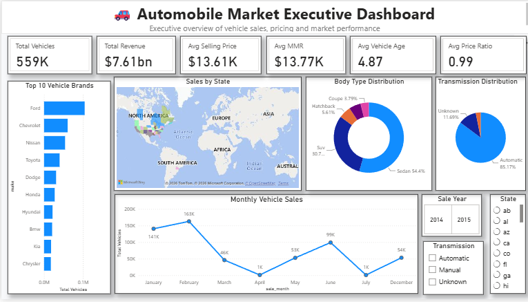
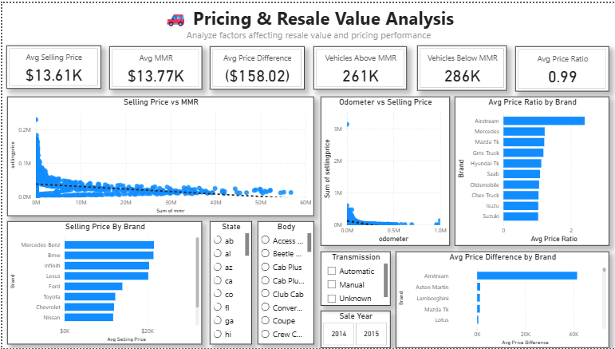
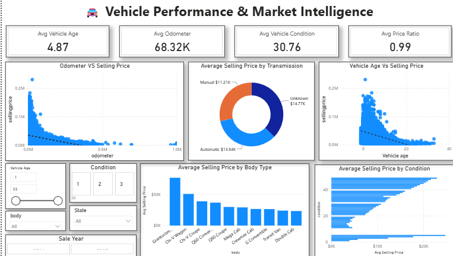
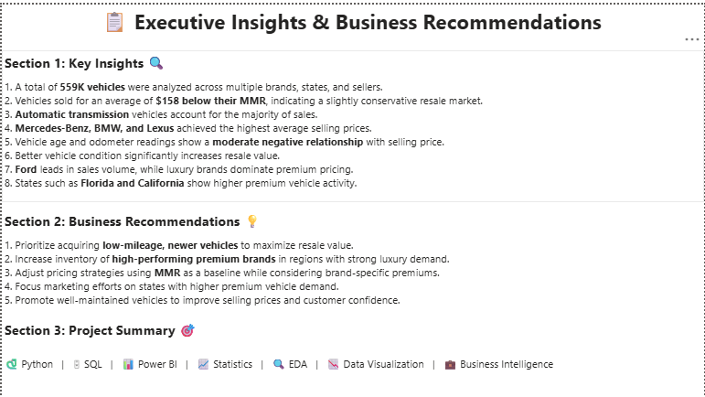

# 🚗 Automobile Market Analysis & Executive Dashboard

An end-to-end Data Analytics project focused on understanding the used automobile market through sales performance, resale pricing, brand analysis, vehicle conditions, and market trends.

The project analyzes **559K vehicle records** using Python, SQL, Statistics, EDA, and Power BI to generate meaningful business insights and actionable recommendations.

---

## 📌 Business Case Study

The used automobile market involves multiple factors that influence vehicle selling prices, including brand, mileage, age, condition, transmission, and location.

The objective of this project is to analyze historical vehicle sales data, understand pricing patterns, compare actual selling prices with Manheim Market Report (MMR), and identify opportunities for better inventory and pricing decisions.

## 🎯 Business Objectives

- Analyze overall vehicle sales and revenue.
- Compare average selling price with MMR.
- Identify top-performing automobile brands.
- Understand the relationship between vehicle age, odometer, and selling price.
- Analyze sales performance across states and vehicle categories.
- Identify market trends and business opportunities.

## 👥 Key Stakeholders

| Stakeholder | Business Requirement |
|---|---|
| Management | Monitor overall market performance |
| Sales Manager | Identify high-performing brands |
| Pricing Team | Analyze selling price against MMR |
| Inventory Team | Identify vehicles with better resale potential |
| Marketing Team | Identify high-demand geographical markets |

---

# 📊 Dashboard Overview

## 1. Automobile Market Executive Dashboard

Provides an overall view of automobile sales performance, including total vehicles, revenue, average selling price, average MMR, vehicle age, and price ratio.

## 2. Pricing & Resale Value Analysis

Analyzes selling prices against MMR, vehicles above and below MMR, odometer readings, and average price differences across brands.

## 3. Vehicle Performance & Market Intelligence

Explores how vehicle age, odometer readings, condition, transmission, and body type influence average selling prices.

## 4. Executive Insights & Business Recommendations

Summarizes the major analytical findings and translates them into actionable business recommendations.

---

# 🔍 Key Business Insights

1. Analyzed approximately **559K vehicles** across multiple brands, states, and sellers.
2. Vehicles sold for an average of **$158 below their MMR**.
3. Automatic transmission vehicles account for the majority of sales.
4. Mercedes-Benz, BMW, and Lexus achieved higher average selling prices.
5. Vehicle age and odometer readings show a moderate negative relationship with selling price.
6. Better vehicle condition is associated with higher resale value.
7. Ford leads in sales volume, while luxury brands dominate premium pricing.
8. Florida and California show higher premium vehicle activity.

---

# 💡 Business Recommendations

1. Prioritize acquiring low-mileage and newer vehicles to maximize resale potential.
2. Increase inventory of high-performing premium brands.
3. Use MMR as a pricing benchmark while considering brand-specific premiums.
4. Focus marketing efforts on states with higher premium vehicle demand.
5. Promote well-maintained vehicles to improve customer confidence and selling prices.

---

# 🧰 Tools & Technologies

| Technology | Purpose |
|---|---|
| Python | Data Cleaning & Analysis |
| SQL | Data Querying |
| Power BI | Interactive Dashboard |
| Statistics | Statistical Analysis |
| EDA | Exploratory Data Analysis |
| Data Visualization | Visual Insights |
| Business Intelligence | Business Recommendations |

---

# 📈 Dashboard Features

- Executive KPI Cards
- Sales Performance Analysis
- Brand-wise Sales Comparison
- State-wise Vehicle Distribution
- Monthly Sales Trends
- Selling Price vs MMR Analysis
- Odometer vs Selling Price
- Vehicle Condition Analysis
- Transmission & Body Type Distribution
- Interactive Filters and Slicers

---

# 💼 Business Value

This project helps business teams understand automobile market behavior, evaluate resale pricing, identify high-performing brands, and make data-driven decisions related to inventory planning, pricing strategies, and regional marketing.

---

# 📚 Key Learning Outcomes

- Analyzed a large-scale dataset containing approximately 559K records.
- Performed data cleaning and exploratory data analysis.
- Applied statistical techniques to identify relationships between variables.
- Compared actual selling prices with market reference values.
- Developed interactive Power BI dashboards.
- Converted analytical findings into actionable business recommendations.

---

# 🗣️ Project Explanation (Interview)

"I developed an Automobile Market Analysis project using Python, SQL, and Power BI. I analyzed approximately 559K vehicle records to understand sales trends, brand performance, and resale pricing.

One of the key objectives was to compare actual selling prices against MMR to understand market pricing differences. I also analyzed how vehicle age, mileage, condition, and transmission affect selling prices.

Finally, I developed an interactive Power BI dashboard with multiple analytical pages and translated the findings into business recommendations for inventory planning, pricing optimization, and marketing strategies."

---

## 👨‍💻 Skills Demonstrated

`Python` `SQL` `Power BI` `Statistics` `EDA` `Data Visualization` `Business Intelligence`
